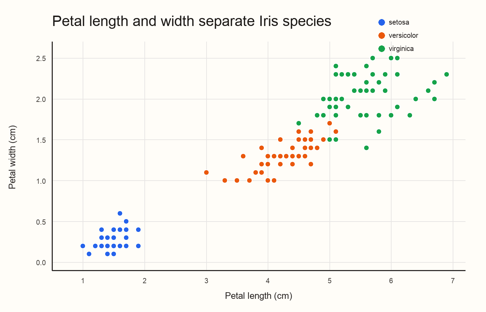
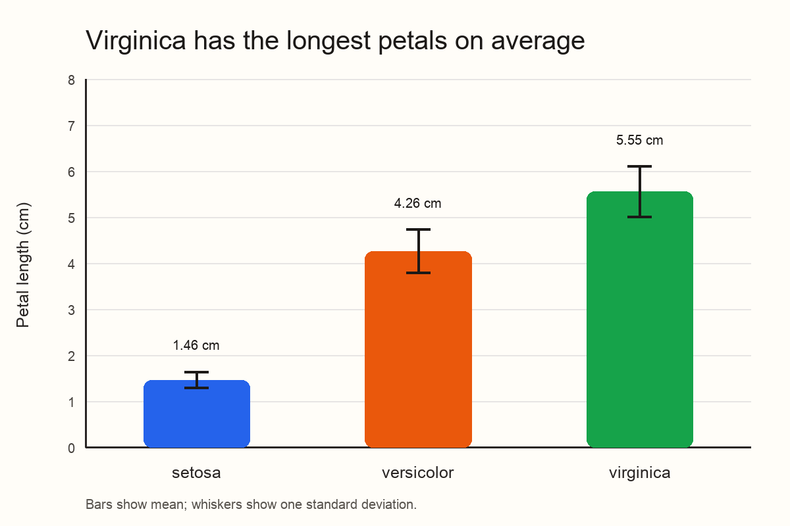
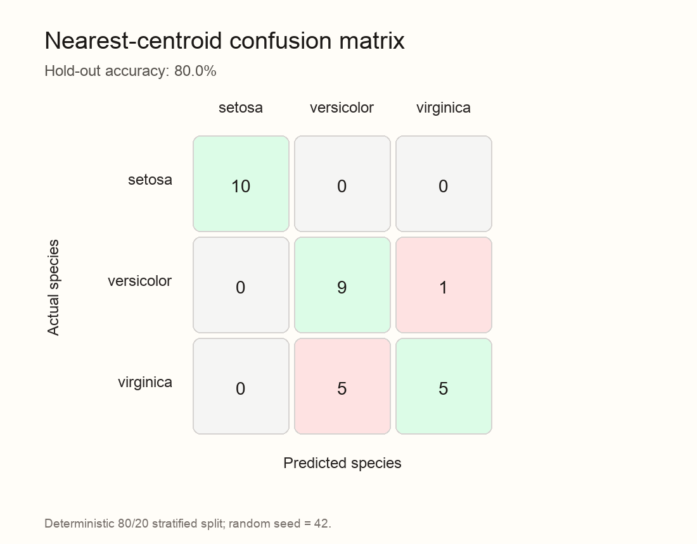

# Iris Species: Measurement Patterns and a Reproducible Classification Baseline

This project explores how four flower measurements differ across three Iris
species: *setosa*, *versicolor*, and *virginica*. It also evaluates a small,
transparent classification baseline to test whether those measurements contain
enough information to distinguish the species.

## Problem and Research Questions

**Main question:** How do sepal and petal measurements differ among Iris species,
and how well can a simple distance-based model classify a flower using those
measurements?

The analysis answers three supporting questions:

1. Which measurements separate the three species most clearly?
2. Which species are most difficult to distinguish?
3. How accurate is a standardized nearest-centroid classifier on unseen data?

## Dataset Source and Usage Permissions

The project uses the canonical Iris dataset collected by R. A. Fisher and
distributed through the UCI Machine Learning Repository. The CSV copy used here
was obtained from the public `seaborn-data` repository:

- Original source: <https://archive.ics.uci.edu/dataset/53/iris>
- Public CSV copy: <https://github.com/mwaskom/seaborn-data/blob/master/iris.csv>
- License: Creative Commons Attribution 4.0 (CC BY 4.0)
- Observations: 150 flowers, 50 per species, with no missing values
- Sensitive data: none; the dataset contains flower measurements only

Attribution: Fisher, R. A. (1936). *The use of multiple measurements in
taxonomic problems*. Annals of Eugenics, 7(2), 179–188.

## Methods and Tools

The analysis uses:

- **Python 3.12**
- **pandas** for loading, validation, summaries, and grouping
- **NumPy** for standardization, distance calculations, and prediction
- **Pillow** for generating publication-ready PNG figures
- **Git and GitHub** for version control and project documentation

The classification experiment uses a deterministic 80/20 stratified train/test
split with random seed `42`. Training features are standardized with their mean
and population standard deviation. Each test observation is assigned to the
closest species centroid. The model is intentionally simple so the logic can be
inspected and reproduced without a machine-learning framework.

## Key Findings

1. **Petal measurements are strongly related.** Petal length and petal width
   have a correlation of **0.963**.
2. **Species differ substantially in petal length.** Mean petal length is
   **1.46 cm** for setosa, **4.26 cm** for versicolor, and **5.55 cm** for
   virginica.
3. **Setosa is clearly separated.** Its petal points form a distinct cluster,
   while versicolor and virginica overlap more.
4. **The baseline performs reasonably but not perfectly.** The nearest-centroid
   model achieves **80.0% hold-out accuracy**. It classifies all 10 test setosa
   flowers correctly, but confuses five virginica flowers with versicolor.

### One Limitation

The dataset is small, balanced, and unusually clean, so the accuracy estimate is
not representative of messy real-world data. In addition, a single 30-flower test
split is sensitive to which observations happen to be held out. A larger sample
and repeated cross-validation would provide a more stable estimate.

## Visualizations

### Petal measurements by species



The petal measurements separate setosa from the other two species. The boundary
between versicolor and virginica is less distinct.

### Mean petal length with variability



Virginica has the longest petals on average, followed by versicolor and setosa.
The whiskers show one standard deviation around each mean.

### Classification results



The confusion matrix shows that most errors involve virginica and versicolor,
which is consistent with the overlap visible in the scatter plot.

## Project Structure

```text
data-science-project/
├── analysis.py
├── data/
│   └── iris.csv
├── figures/
│   ├── confusion_matrix.png
│   ├── petal_scatter.png
│   └── species_means.png
├── results/
│   ├── confusion_matrix.csv
│   ├── metrics.json
│   └── species_summary.csv
├── requirements.txt
└── README.md
```

## Instructions for Running the Analysis

1. Clone the repository and enter its directory:

   ```bash
   git clone https://github.com/FAFH1/data-science-project.git
   cd data-science-project
   ```

2. Create and activate a virtual environment:

   ```bash
   python3 -m venv .venv
   source .venv/bin/activate       # macOS/Linux
   # .venv\Scripts\activate        # Windows
   ```

3. Install the dependencies:

   ```bash
   python -m pip install -r requirements.txt
   ```

4. Run the complete analysis:

   ```bash
   python analysis.py
   ```

The script validates the input data, recreates all three figures in `figures/`,
writes the summary tables and metrics to `results/`, and prints the main findings
to the terminal. No API keys, passwords, or private data are required.

## Reproducibility Notes

- Random seed: `42`
- Train/test split: stratified 80/20
- Figure output format: PNG
- Data validation checks: column names, row count, species count, and missing
  values
